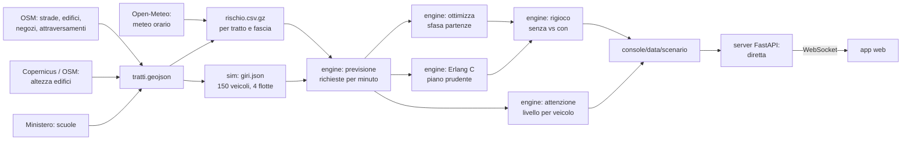

# Architettura

Il motore **precalcola** la giornata della centrale; il server locale la fa **scorrere in diretta** e l'app la mostra. Mappa, motore e app girano sul laptop: la demo non dipende da internet durante il pitch.

## I pezzi

**1. Mappa del rischio** (`data/scripts/`). Divide l'area in tratti di strada e, per ogni tratto e ogni fascia di 5 minuti, calcola la probabilità che un veicolo chieda aiuto passando di lì. Fattori e pesi sono in `config/pesi_rischio.yaml`, fonti e stato in `docs/ipotesi.md`.

**2. Simulatore** (`sim/`). Genera i giri delle 4 flotte della centrale: depositi, fermate su indirizzi veri, percorso più breve sulla rete stradale, velocità del traffico di Roma fino al massimo di ogni veicolo. Non serve fisica realistica: serve sapere *quale tratto* percorre ogni veicolo *a che ora*.

**3. Previsione** (`engine/previsione.py`). Incrocia giri e rischio: per ogni minuto somma le probabilità di tutti i veicoli in strada. Ne esce la curva delle richieste attese.

**4. Turni** (`engine/erlang.py`, `engine/pipeline.py`). Dalla curva calcola quanti operatori servono per prendere il 90% delle richieste entro 20 secondi (Erlang C, la formula dei call center). Il piano prudente rifà il conto con il temporale anticipato e ritardato di un'ora e tiene il massimo; ogni piano si verifica su 20 giornate simulate dalla previsione.

**5. Ottimizzazione** (`engine/ottimizza.py`). Sposta di qualche minuto le partenze delle consegne (le navette no) per abbassare il picco. Algoritmo greedy: per ogni veicolo prova gli spostamenti da −10 a +10 minuti e tiene quello che abbassa di più il picco.

**6. Leve in tempo reale** (`engine/tempo_reale.py`). Sopra il piano: operatori misti, prolungamento del turno, reperibilità e meno richieste, con i preavvisi che una centrale ha davvero.

**7. Rigioco** (`engine/rigioco.py`). Estrae le richieste vere dalle probabilità (stessi numeri casuali per i due casi), le mette in coda davanti agli operatori e misura attese e blocchi, senza e con il sistema.

**8. Griglia dell'attenzione** (`engine/attenzione.py`). Per ogni veicolo e ogni minuto, la probabilità di una richiesta nei prossimi 3 minuti: da qui il livello (nominale, attenzione, critico) e l'Autonomy Confidence Score che l'operatore vede.

**9. Diretta** (`server/diretta.py`). Il server tiene l'orologio della giornata e lo stato delle richieste, come una piattaforma di teleguida: un veicolo che chiede aiuto si ferma finché l'intervento non è finito e poi riparte in ritardo sul suo piano. Manda lo stato a tutte le schermate con una WebSocket; avvio, pausa, velocità e salti nel tempo arrivano dalle schermate.

**10. Registro** (`server/registro.py`). Ogni intervento chiuso dall'operatore, con la causa confermata, si salva subito in un file locale e poi su Supabase, riprovando se manca la rete. Il Registro dell'app lo mostra accanto a quelli del motore.

**11. Copilota** (`server/copilota.py`). Quando l'operatore prende una richiesta, Claude legge via, motivo previsto, score, pioggia e storico della via e risponde con la situazione in due frasi, un'azione suggerita e la nota per il registro. Senza rete o senza chiave c'è un ripiego costruito dai dati del motore.

**12. GPS in diretta** (in `web/src/lib/scenario.ts`). Ogni veicolo prende la precisione del GPS della strada che percorre (stimata dal motore con il rapporto canyon): sopra 10 m è in modalità degradata, lo score scende e sulla mappa compare il cerchio di incertezza.

**13. BOXi in sala** (`telefono/`, `server/dal_vivo.py`). Un telefono manda a Supabase posizione e precisione vere del GPS; il server le legge ogni secondo e lo tratta come un veicolo: al chiuso la precisione peggiora e lo score scende, se smette di mandare segnali va offline. Da critico apre una richiesta per la console.

**14. App** (`web/`). Legge i file di `console/data/scenario/` dal server e la diretta dalla WebSocket. Disegna la mappa 3D con i nostri dati (niente mappe online), anima i veicoli sul loro orologio (ora meno ritardo) e mostra le cinque schermate: console operatore, planner turni, registro, dashboard flotta, configurazione.

## Strumenti di verifica

- `tools/prova_pianificazione.py`: i tre piani con il temporale come previsto, un'ora prima e un'ora dopo (`piani.json`).
- `tools/sensibilita.py`: il risultato con ogni peso a ±50% (`sensibilita.json`).
- `tools/taratura.py`: il peso degli attraversamenti contro il dato di Cruise.

## Perché così

- **Precalcolato:** la demo non deve dipendere dalla rete della sede; il motore fa i conti prima, l'app li rigioca.
- **Formati fissati:** dati, motore e app si sviluppano separatamente; i contratti sono in `docs/formati-dati.md`.
- **Parametri fuori dal codice:** la giuria chiederà "da dove vengono questi numeri". La risposta è `docs/ipotesi.md`.
