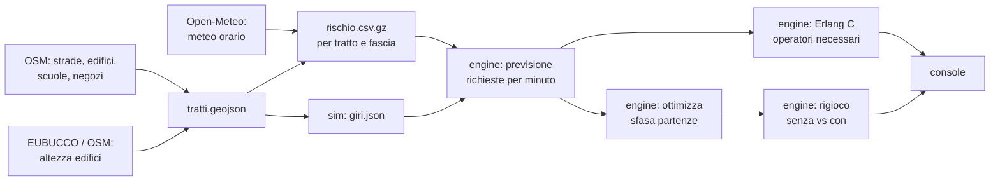

# Architettura

Tutto è **precalcolato e poi rigiocato**: la demo non dipende da internet né da servizi esterni durante il pitch.

## I pezzi

**1. Mappa del rischio** (`data/scripts/`). Divide l'area in tratti di strada e, per ogni tratto e ogni fascia di 5 minuti, calcola la probabilità che un veicolo chieda aiuto passando di lì. I fattori e i pesi sono in `config/pesi_rischio.yaml`.

**2. Simulatore** (`sim/`). Genera i giri di consegna: deposito, fermate su indirizzi veri, percorso più breve sulla rete stradale, velocità massima 25 km/h. Non serve fisica realistica: serve sapere *quale tratto* percorre ogni veicolo *a che ora*.

**3. Previsione** (`engine/previsione.py`). Incrocia giri e rischio: per ogni minuto, somma le probabilità di tutti i veicoli presenti. Ne esce la curva delle richieste attese.

**4. Turni** (`engine/erlang.py`). Dalla curva calcola quanti operatori servono per rispondere al 90% delle richieste entro 20 secondi (formula di Erlang C, la stessa dei call center). **Già implementato e testato.**

**5. Ottimizzazione** (`engine/ottimizza.py`). Sposta di qualche minuto le partenze (entro un limite) per abbassare il picco della curva. Versione semplice: algoritmo greedy che prova per ogni veicolo gli spostamenti da −10 a +10 minuti e tiene quello che abbassa di più il massimo.

**6. Rigioco** (`engine/rigioco.py`). Estrae a caso le richieste vere dalle probabilità (stesso seme per i due casi), le mette in coda davanti agli operatori e misura attese e blocchi in coda, senza e con il sistema. Produce i numeri finali.

**7. Console** (`console/`). Pagina web statica. Disegna le strade dal GeoJSON (niente mappe online), anima i veicoli, mostra i due pannelli affiancati, la coda degli avvisi e i numeri finali.

## Perché così

- **Precalcolato:** 16 ore di hackathon non bastano per un sistema in tempo reale, e il wifi della sede non è affidabile.
- **Formati fissati prima:** dati, motore e console si sviluppano separatamente; la console parte subito con i dati finti.
- **Parametri fuori dal codice:** la giuria chiederà "da dove vengono questi numeri". La risposta è `docs/ipotesi.md`.
